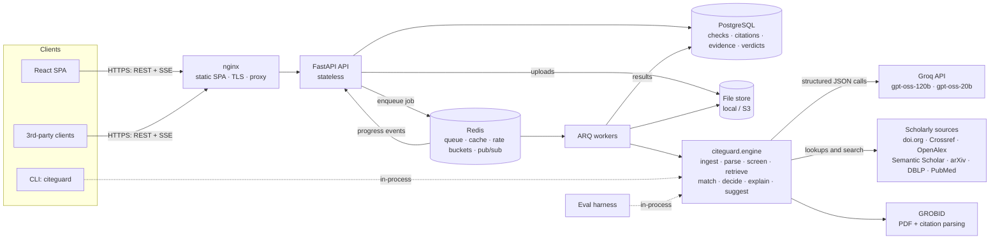
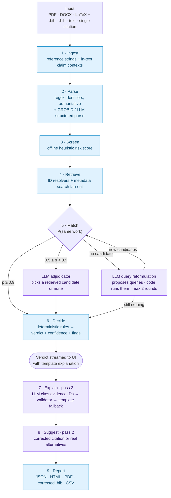
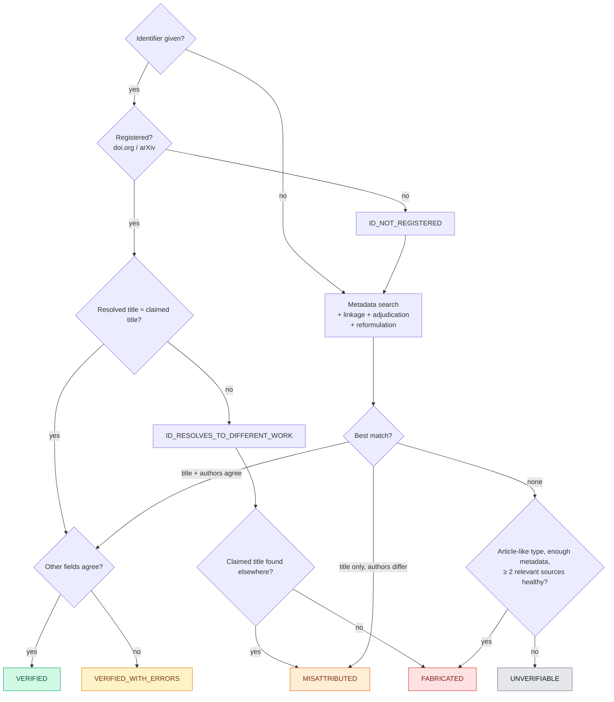
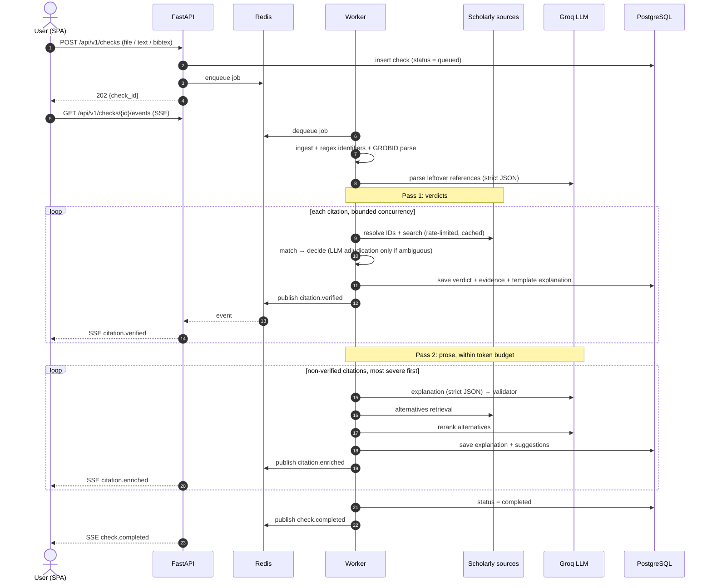

# CiteGuard: Design Document

LLM-based fake citation detection and verification.

Status: IMPLEMENTED (v0.1) · LLM provider: Groq · Design: 2026-10-29 · Updated: 2026-11-02 (see §13)

---

## 0. System at a glance



---

## 1. Problem

LLMs and careless authors produce references that look real but aren't. They fall into a few kinds:

| Kind | Example |
| --- | --- |
| **Fully fabricated** | Plausible title, real-sounding authors, real journal, but no such paper exists |
| **Chimeric** | Title from paper A, authors from paper B |
| **Misattributed** | Real paper with the wrong authors, venue or year |
| **Fabricated identifier** | DOI or arXiv ID that doesn't exist, or that resolves to an unrelated paper |
| **Sloppy but real** | Typos, a year off by one (preprint vs. published), abbreviated venue |
| **Real but retracted** | Exists, but should not be cited |
| **Real but irrelevant** | Exists, but doesn't support the claim it's cited for |

CiteGuard takes a document or a list of references and, for every citation:

1. **Detects** suspicious citations (instant heuristic risk score).
2. **Verifies** it against trusted scholarly databases.
3. **Explains** each inconsistency and *why* a citation is judged fake, grounded only in retrieved evidence.
4. **Suggests** the corrected citation (if the paper exists) or real alternatives (if it doesn't).

### Goals

- G1: Inputs: PDF, DOCX, LaTeX + BibTeX, BibTeX alone, Markdown or plain text (including pasted chatbot answers), and single citation strings.
- G2: Verification against at least 6 sources, with per-field discrepancy reports and links to the evidence.
- G3: Explanations that cite only retrieved evidence and are checked automatically, never taken from the LLM's memory.
- G4: Corrections in the user's style (APA, IEEE, ACM, Chicago, Vancouver, BibTeX) and ranked alternatives.
- G5: Production qualities: async jobs, caching, rate-limit compliance (scholarly APIs *and* Groq), graceful degradation, auth, observability, tests, Docker deployment.
- G6: A reproducible evaluation benchmark with ablations, for the project report.

### Non-goals (v1)

Plagiarism detection; full-text claim checking against paywalled PDFs (abstracts only); multi-tenant SaaS billing; non-English material beyond best effort.

---

## 2. Core design principles

1. **Evidence first, LLM second.** Whether a paper exists is decided by retrieval and deterministic matching. The LLM parses, adjudicates *among retrieved candidates*, proposes reformulated searches, explains, and recommends. It never asserts that a paper exists from its own memory. A hallucination detector must not hallucinate.
2. **"Not found" is not the same as "fake".** Database coverage varies by field and type: books, theses, reports, very recent preprints and non-English work are thinly covered. These get `UNVERIFIABLE`, not `FABRICATED`. Confidence is calibrated against measured coverage.
3. **Every verdict is traceable.** Each verdict carries an evidence bundle: which sources were queried, what they returned, field-level diffs, and links.
4. **Graceful degradation.** If a scholarly source is down, confidence drops and the job still finishes. If the Groq quota runs out, explanations fall back to templates and the job still finishes. With no LLM key at all, the system still runs.
5. **Verdicts fast, prose later.** Verdicts come from a deterministic pass and are streamed immediately. LLM explanations and alternatives fill in afterwards in a second pass that respects the token budget (§5.3).
6. **Untrusted input.** Document text is data, never instructions. LLM outputs are schema-constrained and cannot raise a verdict on their own.

---

## 3. Verdict model

### 3.1 Verdicts (one per citation)

| Verdict | Meaning | UI |
| --- | --- | --- |
| `VERIFIED` | Matches a real record; key fields agree (formatting differences tolerated) | green |
| `VERIFIED_WITH_ERRORS` | Real record found; non-identity fields wrong (year, pages, venue, author typo, bad DOI) | yellow |
| `MISATTRIBUTED` | Real title, but authors substantially wrong; or DOI points to another work; or chimeric | orange |
| `FABRICATED` | No plausible record in any source despite enough metadata to search; or invalid identifiers with no matching work | red |
| `UNVERIFIABLE` | Not enough evidence either way (grey literature, sources unavailable, too little metadata) | grey |

**Flags** that can be added to any verdict: `RETRACTED`, `PREPRINT_HAS_PUBLISHED_VERSION`, `CLAIM_NOT_SUPPORTED` (opt-in claim check), `LOW_PARSE_CONFIDENCE`.

### 3.2 Discrepancy codes (the building blocks of explanations)

`ID_INVALID_SYNTAX`, `ID_NOT_REGISTERED`, `ID_RESOLVES_TO_DIFFERENT_WORK`, `TITLE_NOT_FOUND`, `TITLE_MISMATCH_MINOR|MAJOR`, `FIRST_AUTHOR_MISMATCH`, `AUTHORS_MISSING|EXTRA|FABRICATED|REORDERED`, `YEAR_MISMATCH`, `VENUE_MISMATCH`, `VOLUME_ISSUE_PAGES_MISMATCH`, `PAGES_IMPLAUSIBLE`, `ARXIV_ID_DATE_INCONSISTENT`, `FUTURE_DATE`, `CHIMERIC_TITLE_AUTHORS`, `RETRACTED`.

Each code carries `{field, claimed_value, actual_value, source, evidence_id, severity}`.

---

## 4. Pipeline



Purple steps use the LLM; blue steps are deterministic. Parsing is hybrid.

### 4.1 Ingestion

| Input | Method |
| --- | --- |
| PDF | **GROBID** (`processFulltextDocument`, Apache-2.0): parsed `biblStruct` per reference plus in-text citation markers linked to references, so we get claim context for free. Fallback: `pypdfium2` text extraction, then locate the References heading and segment entries. `pypdfium2` instead of PyMuPDF because PyMuPDF is AGPL. |
| DOCX | `python-docx` → text pipeline |
| LaTeX | `.bib` via `bibtexparser`; `\cite{key}` contexts from `.tex`; `\bibitem` entries; LaTeX de-escaping via `pylatexenc` |
| BibTeX | Already structured; skips LLM parsing entirely |
| Text / Markdown | Find the reference block (heading or numbered list); segment by `[n]`, `n.`, or author-year line starts. Link `[n]` / `(Author, Year)` markers back to entries for context |
| Single citation | Direct parse |

Uploads are validated by magic bytes, capped in size and page count, and never executed.

### 4.2 Parsing

- **Identifiers are extracted by regex first and are authoritative.** No later step may alter them. Patterns: DOI `10.\d{4,9}/\S+` with trailing-punctuation cleanup, arXiv new style (`YYMM.NNNNN`) and old style (`archive/YYMMNNN`), PMID, ISBN-10/13 with checksum.
- **Hybrid structured parse** (`PARSER_STRATEGY=hybrid|llm|grobid|heuristic`, default `hybrid`):
  1. GROBID `processCitationList` when the service is up. It's free, fast, and uses no LLM tokens.
  2. LLM structured parse (batched, about 20 references per call) for references where GROBID is missing or its output fails sanity checks (no title, title not in the raw string).
  3. A heuristic parser as a last resort, with the `LOW_PARSE_CONFIDENCE` flag.
- The target schema is `ParsedReference{authors[{given,family}], title, container_title, year, volume, issue, pages, doi, arxiv_id, pmid, isbn, url, publisher, type, raw}`.
- The LLM prompt requires **faithful transcription: no correcting, completing or normalizing.** A post-check confirms every parsed title fuzzily appears in its raw string; a failing reference drops to the next strategy.

### 4.3 Screening (offline, instant)

Cheap signals shown in the UI before network verification finishes. They also feed into final confidence:

- DOI syntax invalid; DOI prefix doesn't match the claimed publisher (for example `10.1145` is ACM but the venue is an IEEE journal)
- arXiv ID's `YYMM` inconsistent with the claimed year
- Year in the future, or before the venue existed
- Pages: start > end, or an absurd length
- Post-2005 journal article with no DOI
- Venue name not in the known-venue table (curated aliases, extended over time from OpenAlex and DBLP)
- Malformed author list (for example "et al." inside BibTeX `author`)

### 4.4 Retrieval: source adapters

Every adapter implements one protocol: `lookup(identifier)`, `search(ParsedReference, limit)`, plus declared capabilities, rate limits, and coverage tags.

| Source | Used for | Notes |
| --- | --- | --- |
| **doi.org** Handle API + content negotiation | Does this DOI exist, at *any* registration agency (Crossref, DataCite, mEDRA…)? Metadata as CSL-JSON | `/api/handles/{doi}`: responseCode 1 = exists, 100 = not registered |
| **Crossref** REST | DOI metadata, `query.bibliographic` search, retraction/update relations | polite pool (`mailto`) |
| **OpenAlex** | Broad search, `is_retracted`, abstracts | mailto / API key per current policy |
| **Semantic Scholar** Graph API | `/paper/search/match` title matching, DOI/ARXIV lookups, abstracts, relevance search for alternatives | API key recommended |
| **arXiv** API | arXiv ID lookup, preprints | ≤ 1 request / 3 s |
| **DBLP** | CS conferences (coverage Crossref lacks) | implemented but **off by default**: its API now sits behind an anti-bot challenge |
| **PubMed** E-utilities | Biomedical, PMIDs | 3 rps, or 10 with a key |
| **OpenLibrary** | Books / ISBN (reduces false `UNVERIFIABLE`) | later phase |

**Routing.** Lookups run first, then searches on Crossref, OpenAlex and S2, plus specialized sources picked by detected field and type (CS → DBLP and arXiv, biomedical → PubMed). If an identifier lookup yields a strong match, broad searches are skipped to save quota.

**LLM query reformulation.** This runs only when nothing matches, and before any `FABRICATED` verdict. Groq doesn't allow structured output together with tool use, so this is not a tool-calling agent. The LLM returns up to 4 alternative queries as strict JSON: paraphrased title, dropped subtitle, transliterated names, author + topic. Our code runs those queries, at most 2 rounds. The LLM only *surfaces candidates*; the deterministic matcher still decides.

**HTTP infrastructure:**

- One shared `httpx.AsyncClient`
- Per-source token-bucket limiters (in-process for the CLI, Redis-backed for workers so all workers share one quota)
- Retries with exponential backoff and jitter that honor `Retry-After`
- A per-source circuit breaker
- Timeouts

**Cache.** Responses are cached, keyed by source and normalized request, in a disk cache for the CLI and Redis for the service. Hits are kept 30 days; misses are negative-cached for 24 h so newly indexed work still shows up. Raw responses are kept as evidence.

### 4.5 Matching (record linkage)

- **Normalization:** NFKC, LaTeX de-escaping, case and diacritic folding, punctuation stripping, subtitle splitting.
- **Name parsing:** "Last, F." and "F. Last" forms, particles (van, de, al-), initials.
- **Field features:**
  - Title similarity (rapidfuzz token-set and normalized Levenshtein)
  - First-author match
  - Author-set F1 on family names (fuzzy ≥ 0.85) and an order-consistency score
  - Year difference (±1 tolerated for preprint vs. published)
  - Venue similarity through an alias table (NeurIPS = NIPS = "Advances in Neural Information Processing Systems")
  - Exact match on volume, issue and pages
  - Identifier agreement
- **Linkage model:** a logistic model over these features, giving P(same work). It starts from hand-set weights and is refit on the benchmark (§9). Thresholds: ≥ 0.9 match; 0.5–0.9 goes to the **LLM adjudicator**; < 0.5 no match.
- **LLM adjudicator:** sees the claimed citation and the top 3 candidates. It returns `{candidate_id | null, per-field judgements, rationale}` and may only pick from the given IDs. A guard rejects any pick below minimum similarity floors.
- **Chimera detection:** if the title matches work A but the claimed authors match a *different* work B (found by an author+year search), emit `CHIMERIC_TITLE_AUTHORS`.

### 4.6 Decision rules



Flags are computed afterwards: `RETRACTED` (from Crossref/OpenAlex), `PREPRINT_HAS_PUBLISHED_VERSION`, and others.

**Confidence.** For matches, confidence comes from the linkage probability. For `FABRICATED`, it is `1 − P(real work missed | type, field, sources healthy)`, using the **retrieval recall measured on the benchmark** per type and field. If we find 99.5% of real journal articles, not finding one is strong evidence; for conference papers in a thinly covered field it is weaker. Confidence is shown as High/Medium/Low plus a numeric value.

### 4.7 Explanations

The input is a structured **EvidenceBundle**: claimed fields, every source lookup (status, top results, URLs), best match with field diffs, discrepancy codes, verdict, and confidence. Each item has an ID (`ev1`, `ev2`, …).

The output is strict JSON:

```json
{
  "headline": "Likely fabricated: the DOI belongs to a different paper and the title exists in no index.",
  "reasons": [{ "text": "...", "evidence_ids": ["ev1"] }],
  "recommendation": "Replace with one of the suggested papers or remove."
}
```

**Validator.** Every reason must cite existing evidence IDs, and every quoted title, DOI, name or number must appear in the bundle (string containment). On failure: one retry, then a **deterministic template explanation** per discrepancy code. Every citation gets a template explanation in pass 1; the LLM explanation replaces it in pass 2 if it validates.

Illustrative output (fictional example):

> **FABRICATED** (confidence: High, 0.95)
> *Smith, J. & Lee, K. (2021). Contrastive Graph Transformers for Protein Folding. Nature Machine Intelligence, 3(4), 211–223. doi:10.1038/s42256-021-0XXXX*
>
> 1. The DOI is registered, but it resolves to a different article: *"…"* by Zhang et al. (2021). [ev1 · doi.org]
> 2. No work with this title exists in Crossref, OpenAlex, Semantic Scholar or DBLP. The closest title match has 0.41 similarity and shares no authors. [ev2–ev5]
> 3. Reformulated searches (title variants, author + topic) also found nothing. [ev6]
>
> **Suggested alternatives:** 3 real papers on graph transformers for protein structure, each with a one-line relevance note.

### 4.8 Suggestions

- **Correction** (`VERIFIED_WITH_ERRORS`, `MISATTRIBUTED`): the real record formatted in the user's style, with a field-level diff ("year 2020 → 2019; venue ICML → NeurIPS"). Formatting uses doi.org content negotiation (`text/x-bibliography; style=…`, all CSL styles) when a DOI exists, and a built-in formatter otherwise. A corrected BibTeX entry is also produced.
- **Alternatives** (`FABRICATED`, `CLAIM_NOT_SUPPORTED`): build a query from the claimed title, the venue/field, and the **in-text claim context**. Retrieve candidates from S2 and OpenAlex relevance search. Filter out retracted work. An **LLM reranks** the top ~15 using abstracts and returns the top 3 with a relevance note grounded in each abstract. These are clearly labeled "suggestions; read before citing".

### 4.9 Opt-in: claim-support check

For citations that are real and have in-text context, fetch the abstract (OpenAlex/S2). The LLM labels the claim `SUPPORTS | PARTIAL | NOT_SUPPORTED | CANNOT_DETERMINE` with a rationale quoting the abstract. This catches the "real paper, but it doesn't say that" failure. It is abstract-only, so the UI presents it as a hint, not a verdict.

---

## 5. LLM layer (Groq)

### 5.1 Provider and models

- **Provider:** Groq, through the official `groq` Python SDK (`AsyncGroq`).
- Everything goes through a thin `LLMClient` interface that handles schemas, retries, rate limiting, caching and token accounting. Groq is the only implementation in v1; another provider can be added behind the same interface.
- Models were checked against Groq's model page on 2026-10-29. `gpt-oss` models are the *production* models that support **strict** JSON-schema structured outputs; Llama 3.x only offers JSON-object mode, and Qwen/Muse are preview models.

| Stage | Default model | `reasoning_effort` | Mechanism |
| --- | --- | --- | --- |
| Reference parsing (batched) | `openai/gpt-oss-20b` | low | strict `json_schema` |
| Match adjudication | `openai/gpt-oss-120b` | medium | strict `json_schema` |
| Query reformulation | `openai/gpt-oss-20b` | low | strict `json_schema` (queries only; code runs them) |
| Explanation | `openai/gpt-oss-120b` | medium | strict `json_schema` + validator |
| Alternatives rerank / claim check | `openai/gpt-oss-120b` | low | strict `json_schema` |

The model and effort for every stage can be overridden through env vars (`LLM_MODEL_PARSE`, `LLM_MODEL_EXPLAIN`, …), and each stage has a fallback chain (for example `gpt-oss-120b → gpt-oss-20b → template`).

### 5.2 Groq constraints that shape the code

- **Structured outputs cannot be combined with streaming or tool use.** All calls are non-streaming. Reformulation uses "propose queries as JSON" instead of tool calling.
- **Strict-mode schema rules:** every property must be in `required`, every object needs `additionalProperties: false`, and optional fields become `type: [T, "null"]`. A helper converts our Pydantic models to this form, with unit tests, so schemas can't drift.
- `include_reasoning: false`, so responses carry only the JSON.

### 5.3 Rate limits and budget

Limits published for `gpt-oss-120b` / `gpt-oss-20b` on 2026-10-29 are **30 RPM, 1K RPD, 8K TPM, 200K TPD per model** (paid tiers are higher). That makes token budget a first-class design concern:

1. **The LLM is used only where it adds value.** BibTeX input and GROBID-parsed references skip LLM parsing. `VERIFIED` citations keep their template explanation. LLM explanations and alternatives run only for non-verified citations, most severe first.
2. **Two-pass processing.** Pass 1 (verdicts) needs the LLM only for parsing leftovers, adjudication and reformulation. Pass 2 (prose) spends what budget remains.
3. **Per-model limiters** cover RPM, TPM and TPD. They use estimated tokens before each call and are corrected from Groq's `x-ratelimit-remaining-tokens` / `x-ratelimit-remaining-requests` headers. On 429 they honor `retry-after` (the header is set only on 429s).
4. **Spreading stages across models** uses separate per-model quotas: parsing and reformulation on 20b, judgement and prose on 120b.
5. **Fallback chains on 429/5xx**, then template mode. A check never fails because of the LLM.
6. **LLM response cache**, keyed by model + schema + prompt hash. Re-checking the same document costs nothing.
7. **A daily budget guard** (`LLM_DAILY_TOKEN_BUDGET`). The UI shows a banner when explanations fell back to templates.

**Throughput estimate** (to be measured). A 50-reference plain-text paper is about 12K tokens on 20b plus 30–50K tokens on 120b. On the published free limits that's roughly 4 such papers per day, with LLM steps throttled to 8K TPM. Verdicts still arrive quickly because they barely need the LLM. On paid pricing ($0.15 / $0.60 per MTok for 120b) the same paper costs about **$0.01–0.03**.

### 5.4 Safety

- **Prompt-injection guards:**
  - Document text is wrapped as delimited data, and the system prompt says it is untrusted
  - The LLM has no tools
  - Outputs are strict-schema JSON
  - The adjudicator can only choose from given IDs
  - No LLM output can turn `FABRICATED` into `VERIFIED` without a deterministic match
  - Optional: pre-screen claim contexts with Groq's `llama-prompt-guard-2-86m` (preview model, off by default)
- **Privacy:** only reference strings and claim sentences go to Groq, never the full manuscript. An **LLM-off mode** is supported (`LLM_ENABLED=false`).

---

## 6. System architecture

The component diagram is in §0. A check's lifecycle:



- **Engine as a library** (`citeguard.engine`), shared by the worker, the CLI and the eval harness. Same code path everywhere.
- **Async jobs:** documents run as ARQ jobs (asyncio-native, Redis). References in a job run concurrently under a semaphore; global limiters protect quotas.
- **Single-citation fast path:** `POST /checks?sync=true` with one citation returns inline.

### 6.1 Data model (PostgreSQL in production, SQLite for tests and single-node dev)

```text
api_keys(id, name, key_hash sha256, prefix, rate_limit_per_min, created_at, revoked_at)
checks(id, owner_key_id, input_kind, filename, status, progress_total, progress_done,
       options json, summary json, warnings json, error, pipeline_version,
       created_at, started_at, completed_at, expires_at)
check_inputs(check_id PK, content bytes)        -- deleted as soon as the check finishes
citations(id, check_id, ordinal, verdict, confidence, risk_score, enriched,
          result json)                          -- full CitationResult: evidence, candidates,
                                                --   discrepancies, explanation, suggestions
feedback(id, check_id, ordinal, system_verdict, user_verdict, comment, citation_raw, created_at)
```

A citation's evidence trail, candidates and suggestions are always read and written together, so
they are stored as one JSON(B) document per citation instead of separate normalized tables.
Indexed scalar columns (verdict, confidence) cover the queries we run.

**Retention:** uploaded files are deleted right after processing and results after 30 days
(configurable). Users can delete on demand.

### 6.2 REST API (`/api/v1`, OpenAPI auto-generated)

| Method | Path | Purpose |
| --- | --- | --- |
| POST | `/checks` | multipart file, or JSON `{text}` / `{bibtex}` / `{citation}` + options. Returns `202 {check_id}`; `?sync=true` for a single citation |
| GET | `/checks/{id}` | status, summary, citations with verdicts |
| GET | `/checks/{id}/events` | SSE: `citation.parsed`, `citation.verified`, `citation.enriched`, `check.completed` |
| GET | `/checks/{id}/citations/{cid}` | full detail + evidence bundle |
| GET | `/checks/{id}/export?format=json\|html\|md\|bib\|csv` | reports; `bib` = corrected bibliography |
| POST | `/checks/{id}/citations/{cid}/feedback` | user disagrees with a verdict |
| DELETE | `/checks/{id}` | delete data |
| GET | `/sources/health` | live per-source status, circuit-breaker state, LLM budget left |
| GET | `/healthz` `/readyz` `/metrics` | ops |

**Auth:** API keys (`cg_` + 256 random bits, stored as SHA-256 hashes, which is appropriate for high-entropy tokens) plus an optional admin key from the environment. The SPA sends the key in a header, kept in the browser's local storage. Checks are scoped to the key that created them. Check-creating endpoints are rate-limited per key.

### 6.3 Frontend (React + TypeScript + Vite + Tailwind + TanStack Query)

- **New check:** drag-and-drop file, paste text or BibTeX, or a single-citation box; options panel.
- **Live view:** citations stream in via SSE: instant risk score, then the verdict, then the LLM explanation.
- **Report:** summary bar (counts by verdict), a table sorted by risk with filters and search, and an export menu.
- **Citation drawer:**
  - Claimed vs. matched record side by side, with field-level diff highlighting
  - Verdict badge and confidence
  - Explanation with clickable evidence chips (DOI, OpenAlex, S2 links)
  - Suggestions with copy-as-BibTeX/APA/IEEE
  - Feedback buttons
- Light and dark themes; accessible (keyboard navigation, ARIA, contrast).
- API types generated from the OpenAPI spec, so frontend and backend can't drift.

### 6.4 CLI

`citeguard check paper.pdf --format table|json --style ieee --fail-on fabricated,misattributed` exits non-zero on findings. It runs the engine in-process and needs no server. Usable as a CI gate, for example a GitHub Action on a LaTeX repo.

---

## 7. Non-functional requirements

| Area | Target / approach |
| --- | --- |
| Latency | Single citation verdict p50 ≤ 5 s on a cache miss. 50-reference paper: all verdicts p50 ≤ 90 s; LLM prose bounded by the Groq tier |
| Throughput | Scales with workers; Redis-shared limiters keep us inside each source's and each Groq model's limits |
| Availability | Any single source down: the job still completes with reduced confidence and a banner. Groq down or out of quota: template explanations |
| Observability | `structlog` JSON logs with check/citation correlation IDs. Prometheus metrics: per-source requests, latency, errors, cache hit rate, breaker state; LLM tokens per stage and model, 429 count, budget left; verdict distribution; job duration |
| Security | Upload validation; size and page caps; per-key rate limits; restricted CORS; secrets only via env; output escaping; dependency scanning in CI |
| Privacy | Minimal data to the LLM; retention limits; LLM-off mode; outbound queries contain only titles and authors |
| Polite API use | Contact email in User-Agent; respect documented limits; aggressive caching |

---

## 8. Tech stack

| Layer | Choice |
| --- | --- |
| Language | Python 3.13 (backend); TypeScript (frontend) |
| API | FastAPI, Pydantic v2, uvicorn |
| Jobs | ARQ (asyncio + Redis) |
| DB | PostgreSQL 16, SQLAlchemy 2 (async, asyncpg), Alembic |
| Cache / queue / limits | Redis 7 (service); diskcache (CLI) |
| HTTP | httpx, tenacity-style retry with jitter |
| Parsing | GROBID, pypdfium2, python-docx, bibtexparser, pylatexenc |
| Matching | rapidfuzz, logistic linkage model |
| LLM | `groq` SDK (`AsyncGroq`), strict JSON-schema structured outputs |
| Reports | Jinja2 HTML (print-friendly; print to PDF), CSV, Markdown, corrected BibTeX |
| CLI | Typer + Rich |
| Frontend | React, Vite, Tailwind, TanStack Query, React Router |
| Quality | venv + pip (pyproject is uv-compatible), ruff, mypy, pytest, pytest-asyncio, respx; Vitest + Playwright |
| Deploy | Docker Compose (api, worker, postgres, redis, grobid, web); GitHub Actions CI |

---

## 9. Evaluation (the project's research contribution)

### 9.1 Benchmark: CiteBench (built by us, versioned in `eval/`)

| Split | Size | Construction | Expected label |
| --- | --- | --- | --- |
| Real | ~1,000 | Stratified sample from OpenAlex across fields, years and types, rendered in several citation styles | `VERIFIED` |
| Perturbed | ~500 | Controlled edits of real references: year ±N, venue swap, author drop/insert/swap, title word substitution, fabricated DOI, DOI from another paper, chimeric merge | `VERIFIED_WITH_ERRORS` / `MISATTRIBUTED` / `FABRICATED` per edit type |
| LLM-hallucinated | ~300 | Ask several LLMs (Groq-hosted models included) for literature reviews with references on niche topics; manually label (two annotators on a subset, Cohen's κ reported) | mixed |
| Hard negatives | ~200 | Real but hard: books, theses, reports, non-English, < 3 months old | `VERIFIED` / `UNVERIFIABLE` (never `FABRICATED`) |

### 9.2 Metrics

- **Fake detection** (`FABRICATED` ∪ `MISATTRIBUTED` vs. real): precision, recall, F1, and the **false-positive rate on real citations**, which is the metric that matters most to users.
- Verdict-level macro-F1 and confusion matrix; confidence calibration (ECE, reliability diagram).
- **Explanation faithfulness:** automatic (evidence-ID validity, quoted-span containment), an LLM-as-judge rubric, and human ratings on 100 samples.
- **Suggestions:** correction exact-match (right DOI); alternatives relevance@3 (human-rated).
- **Ops:** latency p50/p95, source calls per citation, LLM tokens per citation.

### 9.3 Ablations and baselines

1. **LLM-only baseline:** ask `gpt-oss-120b` "is this citation real?" with no retrieval. Shows why grounding matters.
2. Heuristics only
3. \+ exact identifier and title lookup
4. \+ fuzzy linkage model
5. \+ LLM parsing
6. \+ LLM adjudication and query reformulation (full system)

The eval runner reuses the engine's rate limiter and LLM cache, so runs can be resumed. A small fixed subset runs in CI as a regression gate.

---

## 10. Repository layout

```text
ILLM_Project/
├── backend/
│   ├── pyproject.toml
│   ├── src/citeguard/
│   │   ├── config.py               # pydantic-settings
│   │   ├── domain/                 # ParsedReference, Record, Evidence, Discrepancy, Verdict…
│   │   ├── ingest/                 # grobid, pdf_text, docx, latex, bibtex, text_segmenter
│   │   ├── parse/                  # identifiers (regex), llm_parser, heuristic parser
│   │   ├── screen/                 # heuristic risk signals
│   │   ├── sources/                # base (http, ratelimit, cache, breaker) + one module per source
│   │   ├── match/                  # normalize, names, venues (aliases), features, linkage model
│   │   ├── verify/                 # orchestrator, rules, confidence, reformulation
│   │   ├── llm/                    # Groq client, strict-schema helper, prompts, limiter, cache
│   │   ├── explain/                # llm explainer, validator, templates
│   │   ├── suggest/                # corrections, alternatives, formatting
│   │   ├── report/                 # json / html / pdf / bib / csv exporters
│   │   ├── api/                    # app, routers, auth, sse, deps
│   │   ├── worker/                 # arq tasks
│   │   ├── db/                     # models, repositories
│   │   ├── observability/          # logging, metrics
│   │   └── cli.py
│   ├── alembic/
│   └── tests/{unit,integration,fixtures}/
├── frontend/                       # Vite + React + TS
├── eval/                           # builders/, datasets/, run_eval.py, reports/
├── deploy/                         # docker-compose.yml, Dockerfiles, nginx.conf
├── docs/                           # DESIGN.md, API.md, EVALUATION.md, RUNBOOK.md
├── .github/workflows/              # ci.yml
└── Makefile
```

---

## 11. Build plan

Each phase ends in a working, tested increment.

| Phase | Deliverable | Demo |
| --- | --- | --- |
| **0 Foundations** | Repo scaffold, tooling, config, domain models, CI | `make test` green |
| **1 Verification core** | Identifier regex, BibTeX and text input, source adapters with rate limiting, caching, retries and breakers; matching; decision rules; template explanations; CLI | `citeguard check refs.bib`, a real verdict table with **no LLM** |
| **2 LLM layer (Groq)** | Strict-schema client, limiter, cache, LLM parsing, adjudicator, reformulation, grounded explanations + validator, corrections + alternatives | Pasted chatbot answer → fake refs explained, with alternatives |
| **3 Service** | Postgres schema + migrations, FastAPI endpoints, ARQ worker, SSE, auth, exports | `curl` a document, stream results |
| **4 Ingestion** | GROBID + fallback PDF, DOCX, LaTeX, context linking | Upload a real paper |
| **5 Frontend** | Full UI described in §6.3 | End-to-end in the browser |
| **6 Evaluation** | CiteBench builders, runner, metrics, ablations, report | Results tables and plots for the write-up |
| **7 Hardening** | Security pass, load test, runbook, docs | `docker compose up` production profile |

---

## 12. Decisions

| Question | Decision |
| --- | --- |
| LLM provider | **Groq** (`openai/gpt-oss-120b`, `openai/gpt-oss-20b`) |
| UI scope | Full web app + API + CLI |
| PDF parsing | GROBID as an optional Compose service, plus a lightweight fallback |
| Deployment | Local Docker Compose |
| Name | CiteGuard (placeholder) |

### Keys and config

- `GROQ_API_KEY` (Phase 2)
- `CONTACT_EMAIL` for the Crossref/OpenAlex polite pools
- Optional: `S2_API_KEY` (Semantic Scholar, free, higher limits), `NCBI_API_KEY`

---

## 13. Implementation notes (as built, 2026-11-02)

What changed relative to the design above, and why:

| Area | As built | Reason |
| --- | --- | --- |
| DBLP | Adapter implemented, disabled by default | DBLP's API sits behind an anti-bot interstitial that rejects programmatic clients; the HTTP layer treats such HTML responses as errors so the circuit breaker trips |
| Year rule | ±1 year is tolerated only when the sources disagree among themselves (online-first vs. print). When all sources agree, an off-by-one year is a `MINOR` error | Live testing: "Nature 2016" for a 2015 paper was wrongly tolerated |
| Preprints | Repository venues (arXiv, bioRxiv, Zenodo, SSRN, Research Square, HAL…) are never compared against conference/journal venues | OpenAlex reports arXiv versions as "arXiv (Cornell University)"; comparing that with "NeurIPS" produced false venue errors |
| Duplicates | Late re-deposits that share a famous title (e.g. 2025 Zenodo copies of a 2017 paper) are excluded when merging the corrected record | Live testing: corrections pulled a 2026 Zenodo record |
| Reformulation | The LLM proposes queries as strict JSON and our code runs them (≤ 4 queries) | Groq structured outputs cannot be combined with tool use |
| Jobs | `inline` backend (asyncio, SQLite or Postgres) for single-node use, `arq` + Redis for scale-out. Both use the same `execute_check` | One code path; easy local runs |
| Restarts | Graceful drain on shutdown. Interrupted checks are re-queued (inline) or retried by ARQ. Per-citation upserts make re-runs idempotent | Found by a flaky test that cancelled a check mid-write |
| UI auth | API key in the browser instead of login + session cookie | Single-organization v1 |
| PDF export | HTML report designed for printing | Avoids WeasyPrint's native dependencies in the image |
| Parse recovery | Before calling an unconfirmed citation fabricated, the verifier checks whether a retrieved record's title and first author appear word for word in the raw citation, as a whole segment. If so, it re-parses around that title and verifies again. When the DOI and the searches found nothing, it first runs one Crossref search on the raw string | Held-out evaluation: author names the parser could not read ("Van Tinteren H", "Šubic-Kovač M") turned the author list into the "title", and real papers were called fabricated |
| Author checks | `AUTHORS_FABRICATED` is decided on precision (the share of listed authors who are on the paper), not F1. A correct but incomplete list (BibTeX with the first 2 of 8 authors) is an `AUTHORS_MISSING` note. A chimera needs the other work to carry most of the listed authors, not one shared surname | Docker smoke test: "Vaswani & Shazeer, Attention Is All You Need" was called misattributed, and a fuzzy author search matched a bioethics paper by another Vaswani |
| Claim check (§4.9) | Opt-in (`check_claims`, or `claim` for one citation). It covers `VERIFIED` and `VERIFIED_WITH_ERRORS` citations that have citing sentences, at most 3 per reference. The abstract comes from records already retrieved, else a DOI lookup in OpenAlex, then Semantic Scholar. Without an abstract the label is `CANNOT_DETERMINE` and no LLM call is made. The LLM's quote must appear verbatim in the abstract (after folding case and punctuation); one retry with feedback, then the judgement is downgraded to `CANNOT_DETERMINE` and never shown as a finding. `NOT_SUPPORTED` adds the `CLAIM_NOT_SUPPORTED` flag and searches for papers matching the sentence, excluding the cited one | Keeps the abstract-only check a grounded hint, and spends no tokens when there is nothing to read |
| Alternatives rerank | An empty LLM answer means "none of these fit" and is respected; only a failed call falls back to keyword ranking | Live test: for a nonsense claim the LLM rightly picked none, and keyword matches were shown anyway |
| Report escaping (security fix) | The HTML report template (`report.html.j2`) was not autoescaped, because `select_autoescape(["html"])` does not match `*.html.j2`. Citation text could inject script into a page served on the app's origin, where the API key sits in localStorage. Now: escaping on by default, links limited to http(s), the report served with a no-script CSP, and the upload filename sanitised in `Content-Disposition` | Found while adding the claim section to the report |
| Explanation check | Besides grounding (evidence IDs, quoted titles, DOIs, years), an LLM headline may not call a citation fake unless the verdict is FABRICATED or MISATTRIBUTED | The LLM wrote "Could not verify: citation appears fabricated" |

The benchmark splits (`eval/datasets/citebench_*.jsonl`) and results are described in
[EVALUATION.md](EVALUATION.md).
